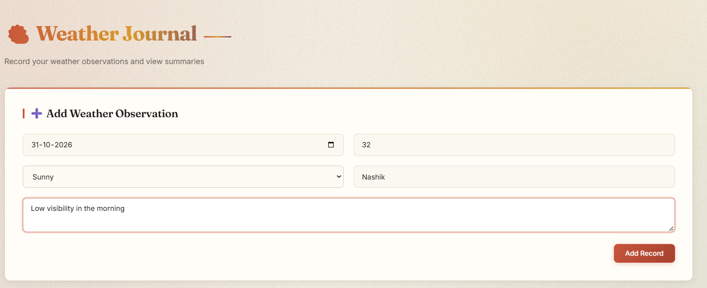
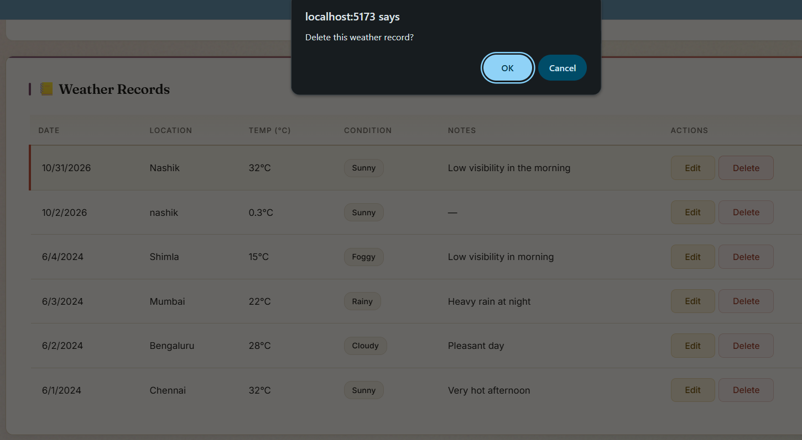
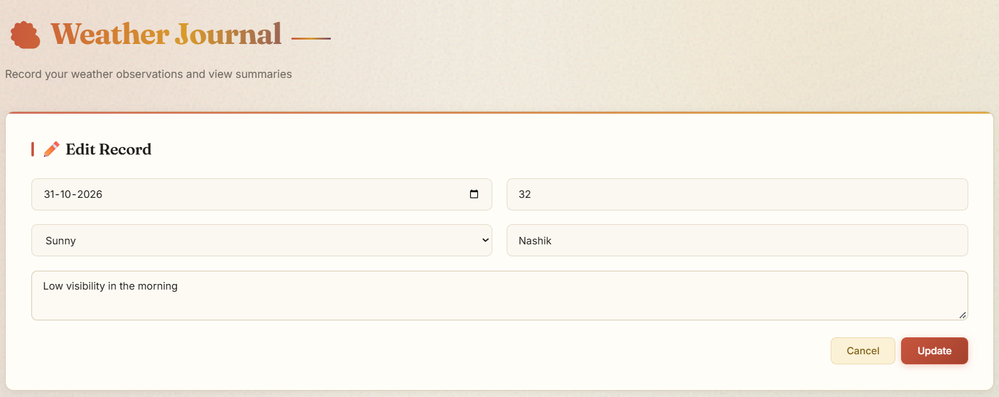
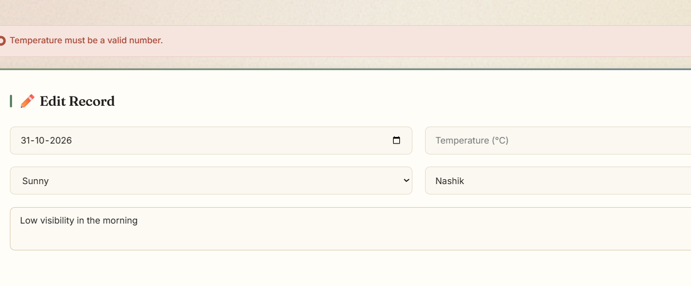
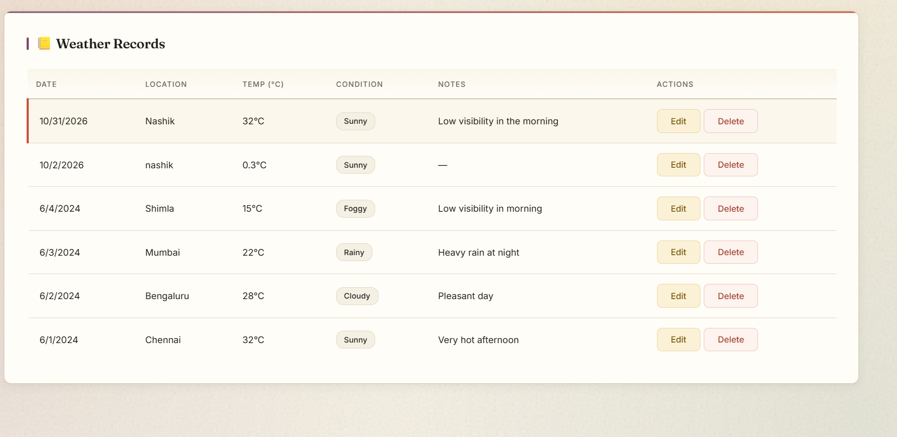
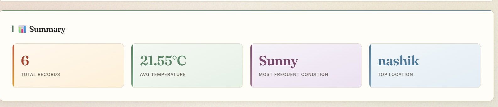
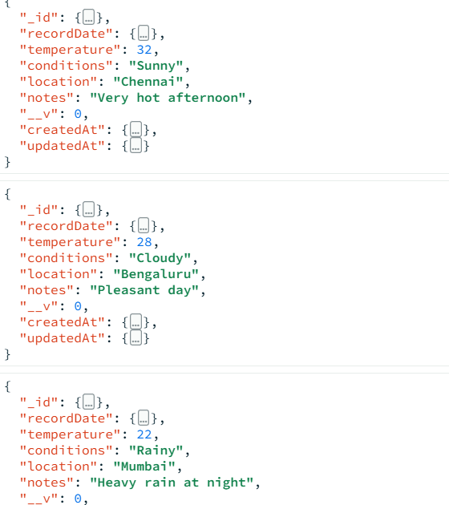

# 🌤️ Weather Journal

A full-stack **MERN** (MongoDB, Express, React, Node.js) application designed to record weather observations and view dynamic statistical summaries. 

The application features a custom, responsive, editorial-style UI with color-coded weather conditions, smooth micro-animations, and a layout optimized for wide screens. 

---

## 📸 Screenshots








---

## ✨ Key Features

- **Complete CRUD Functionality:** Create, Read, Update, and Delete weather records seamlessly.
- **MongoDB Aggregations:** Dynamic summary cards calculate Total Records, Average Temperature, Most Frequent Condition, and Top Location on the fly.
- **Robust Validation:** Mongoose schema validation (backend) combined with real-time client-side validation (frontend) ensures data integrity (e.g., temperature limits, required fields).
- **Responsive & Stylish Design:** Custom vanilla CSS utilizing CSS Grid, Flexbox, and variables. The UI uses a warm "paper" aesthetic with distinct accent colors (Terracotta, Gold, Sage, Plum, Sky).
- **RESTful API:** Fully separated client and server architecture utilizing Axios for API requests.
- **Vite Proxy:** Frontend development server is configured to proxy `/api` requests to the Express backend, avoiding CORS issues.

---

## 🛠️ Tech Stack

**Frontend:**
- React.js (Bootstrapped with Vite)
- Axios (HTTP Client)
- Custom Vanilla CSS

**Backend:**
- Node.js & Express.js
- MongoDB & Mongoose (ODM)
- CORS & Dotenv

---

## 📁 Project Structure & Explanation

```text
weather-journal/
│
├── backend/                  # Express.js Server
│   ├── middleware/
│   │   └── errorHandler.js   # Global error handling & Mongoose validation formatting
│   ├── models/
│   │   └── Weather.js        # Mongoose Schema (Date, Temp, Condition, Location, Notes)
│   ├── routes/
│   │   └── weatherRoutes.js  # All CRUD routes + Aggregation pipeline for stats
│   ├── .env                  # Environment variables (Port, MongoDB URI)
│   ├── seed.js               # Script to populate database with sample data
│   ├── server.js             # Entry point: Express app setup & DB connection
│   └── package.json
│
└── frontend/                 # React + Vite Application
    ├── src/
    │   ├── components/
    │   │   ├── Message.jsx       # Success/Error alert component
    │   │   ├── WeatherForm.jsx   # Form for adding/editing records (handles validation)
    │   │   ├── WeatherList.jsx   # Table displaying records with Edit/Delete actions
    │   │   └── WeatherSummary.jsx# Cards showing aggregated MongoDB statistics
    │   ├── App.css               # Global styles (Animations, color palette, layouts)
    │   ├── App.jsx               # Main component (State management, API fetching)
    │   └── main.jsx              # React DOM entry point
    ├── index.html
    ├── vite.config.js            # Vite config (includes API proxy to backend)
    └── package.json
    ```
